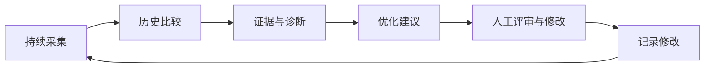

# rankloop

Continuous SEO & GEO monitoring, analysis, and AI-powered optimization.

rankloop 是面向个人与小型团队、支持多站点的可自行部署 SEO / GEO 持续监控项目。通过搜索表现、页面巡检和 AI 回答采样积累证据，帮助使用者发现变化、确定优化动作，并持续追踪结果。

**当前状态：设计阶段。仓库目前仅包含文档，尚未实现应用、连接器或部署配置。** 下文中的功能、技术栈和验收项描述的是 MVP 目标，不代表已经可用。

## 设计文档

建议按以下顺序阅读：

1. [MVP 功能与验收](docs/mvp.md)：用户场景、监控范围、指标、调度、里程碑和完成条件。
2. [技术方案](docs/technical-design.md)：架构、采集链路、数据模型、可靠性、安全和开源交付标准。
3. [模型与 Agent 设计](docs/model-provider-design.md)：供应商无关的模型配置、协议适配、能力校验、Agent 工具边界和 GEO 可比性。

## 核心原则

- 自用优先、多站点隔离，按可供他人部署和贡献的开源项目标准建设。
- 搜索实际表现、页面检查、AI 回答采样分别统计，所有结论可以追溯证据。
- 模型供应商和模型名称可配置；支持 OpenAI、Anthropic / Claude、DeepSeek、小米 MiMo 等服务及兼容接口，不将业务逻辑绑定某家 SDK。
- Agent 分析与 GEO 监测使用独立配置。具备文本生成能力不代表具备原生搜索或可验证引用能力。
- 默认由人评审优化建议；采集、计算和监控不依赖 Agent 自由决定执行。
- 代码公开与部署实例的数据访问独立；凭据和真实监控数据不得进入仓库。

## 开源状态

许可证仍待项目维护者选择，本次文档提交不授予额外的软件许可。正式开放贡献前需补齐 LICENSE、贡献指南、安全披露渠道、演示模式、部署说明与 CI；这些文件的交付标准见技术方案。
