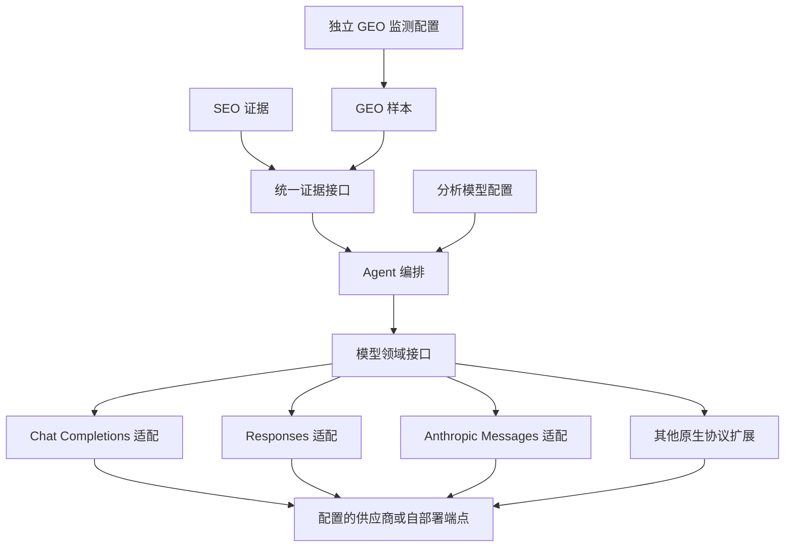
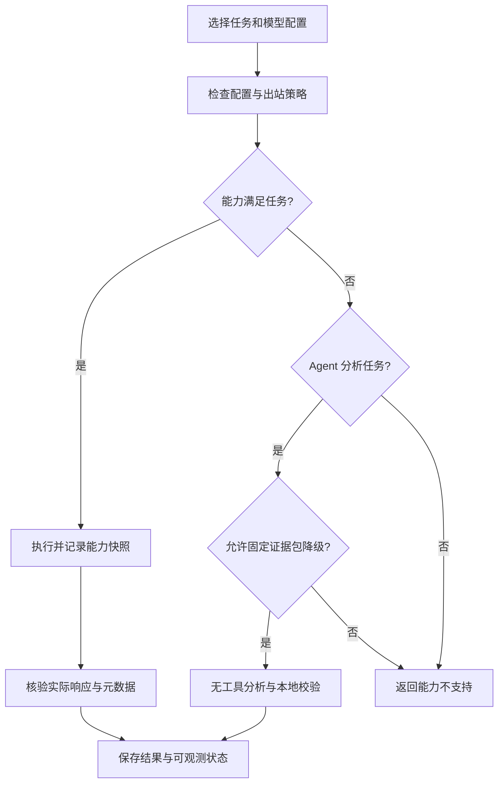
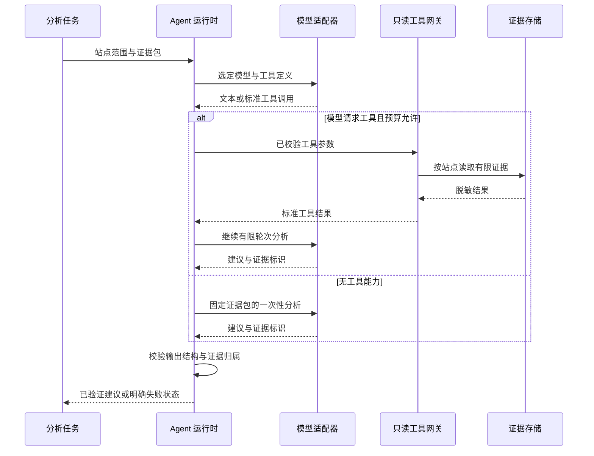
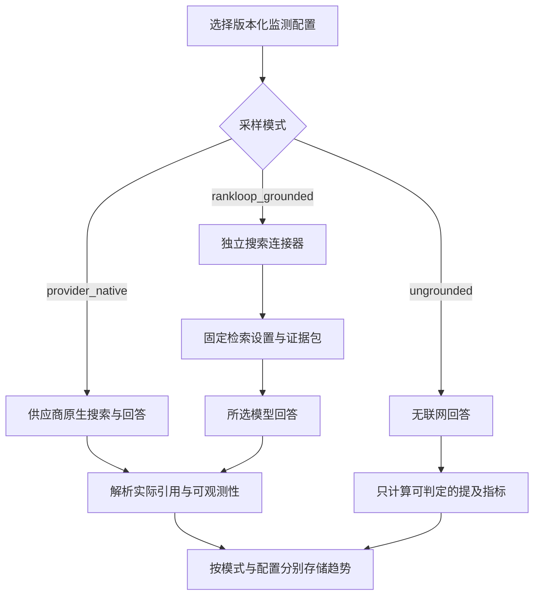

# 模型与 Agent 设计：供应商可替换、能力可验证

日期：2026-10-27。状态：MVP 设计要求，适配器尚未实现。

关联文档：[MVP 功能与验收](mvp.md) · [整体技术方案](technical-design.md)

## 1. 设计决策

**rankloop 的 Agent 不绑定任何单一模型厂商。** 模型供应商、协议、接口地址、模型名称、能力、参数和任务用途均可配置。OpenAI、Anthropic / Claude、DeepSeek、小米 MiMo 只是可选部署配置，不能作为业务层硬编码枚举。

采用“领域接口 → 协议适配 → 供应商差异扩展”的分层设计。使用兼容协议接入某厂商，不意味着必须使用该协议原厂服务或 SDK，也不意味着所有兼容端点拥有相同能力。

### 1.1 分开配置两类模型用途

| 用途 | 输入 | 输出 | 切换原则 |
| --- | --- | --- | --- |
| Agent 分析 | SEO / GEO 指标、公开页面摘要和受控证据 | 解释、建议、优先级与草稿 | 可由用户改选模型；记录分析配置，fallback 需显式允许 |
| GEO 监测 | 固定问题、监测模式、语言和地区等配置 | 待测模型回答、提及与引用 | 绑定配置版本，不跨模型静默 fallback |

例如，可以用 DeepSeek 或小米模型分析 OpenAI、Claude 或其他接口的 GEO 样本；也可以用自部署模型生成周报。没有原生搜索能力的模型仍可执行证据分析，不能因此被自动当作原生 AI 搜索监测接口。

## 2. 方案权衡

| 方案 | 问题或收益 | 决策 |
| --- | --- | --- |
| 直接在业务里调用某家 Agent SDK | 上手快，但领域对象、工具和状态可能绑定厂商 | 不采用作为领域边界 |
| 所有厂商一律当作同一兼容接口 | 配置简单，但会错误假设工具、搜索与引用语义一致 | 不采用 |
| 自有小接口加协议适配器 | 能保持边界并显式处理差异，需契约测试 | 采用 |
| 外部统一模型网关 | 可作为部署者选择的端点，但多一层路由与数据出站 | 可选，不作为必需依赖 |

模型客户端可以复用成熟 SDK，但 SDK 类型不得进入 core、数据库指标或 Agent 工具契约。无需在 MVP 构建通用 Agent 框架；执行可审计的有限分析流程即可。

## 3. 配置模型

### 3.1 Provider、Model Profile 与任务绑定

| 对象 | 非敏感字段 | 约束 |
| --- | --- | --- |
| Provider | 自定义 ID、显示名称、协议类型、受信 base URL、凭据引用、允许的出站范围 | 仅管理员配置；不保存认证明文；供应商 ID 不限固定名单 |
| Model Profile | provider 引用、模型字符串、输入与输出上限、超时、可支持参数、能力声明 | 模型名由使用者输入或显式发现，不自动改成“最新模型” |
| Capability Snapshot | 声明值、验证结果、验证时间、适配器版本、未知或不支持原因 | 验证按端点、模型与配置执行，不按品牌名称猜测 |
| Analysis Binding | 站点或实例默认分析配置、允许的备选配置、步数与费用预算 | 备选数据出站需明确许可；失败不触发任意供应商切换 |
| GEO Profile | 模型配置版本、采样模式、问题集版本、语言、请求地区、搜索选项与重复数 | 修改生成新版本；不得改写历史运行配置 |

实例可以提供默认配置，站点显式覆盖。机密值由环境变量或批准的秘密管理系统注入，配置导出仅包含非敏感字段和引用。运行时引用解析不能出现在模型上下文、日志和响应中。

供应商专有参数通过对应适配器的类型与允许列表验证，不把任意 JSON 原样传入底层请求。未知参数明确拒绝；不支持的通用参数不得静默忽略。

### 3.2 能力矩阵

每项能力使用 supported、unsupported、unknown 状态，并记录声明与验证证据。使用者修改声明不等于完成兼容性验证。

| 能力 | 用途 | 不支持时 |
| --- | --- | --- |
| text_generation | 所有分析与回答 | 禁用该配置的生成任务 |
| structured_output | 受约束结果 | 使用文本生成加本地 schema 校验和有限修复，并标注降级 |
| client_tools | 模型请求 rankloop 只读工具 | 使用固定证据包的一次性分析，禁止模拟执行工具 |
| native_search | 供应商原生联网回答 | 不能运行 provider_native 采样 |
| answer_citations | 可验证的回答实际引用 | 引用率不可观测，不能按零引用计算 |
| consulted_sources | 搜索时查看过的来源 | 单独标记缺失，不影响可判定的实际引用 |
| usage_reporting | 用量核算 | 费用显示未知，调用数硬上限继续生效 |
| region_control | 请求地区可控制 | 显示不可控制，不伪造地区可比性 |

## 4. MVP 协议适配范围

MVP 提供以下三类协议适配目标，不将厂商名称作为协议类型：

| 协议类型 | 主要职责 | 厂商接入方式 |
| --- | --- | --- |
| chat_completions | 消息、工具、生成参数、用量与错误转换 | OpenAI 兼容端点；DeepSeek、小米等按实际文档配置 |
| responses | Responses 输入输出、工具事件与来源转换 | OpenAI 或其他明确支持该协议的端点 |
| anthropic_messages | 消息块、tool_use / tool_result、结束状态与用量 | Anthropic / Claude 或明确兼容的端点 |

Gemini 或未来其他原生协议通过适配器注册扩展，不能因未实现某协议而宣称该厂商已可用。首版必须完成上述三类协议的合成契约测试，并使用部署者选定的真实配置验证跨厂商切换；不要求默认 CI 持有全部厂商账号。

DeepSeek 官方文档说明兼容 OpenAI / Anthropic 格式；小米 MiMo 提供 Responses 兼容文档，同时列出不支持或语义不同的参数。这说明“修改端点即可接入”仍需要能力和参数验证。[DeepSeek 官方文档](https://api-docs.deepseek.com/api/responses)、[小米 MiMo 官方文档](https://mimo.mi.com/docs/en-US/api/chat/responses)

Anthropic Messages 将工具调用表示为消息块，适配器需规范化该差异，而不是让业务逻辑读取厂商块结构。[Anthropic 官方接口](https://platform.claude.com/docs/en/api/messages/create)

对每个协议，统一处理文本输出、结束原因、可用工具调用、usage、响应模型标识、拒绝与错误。流式输出不作为 MVP 的硬依赖。供应商专有推理状态仅在完成工具回传所必需时由适配器维护，不进入指标，也不公开展示隐藏推理内容。

## 5. Agent 运行时与工具边界

Agent 先从确定性计算中获得证据，再在有限范围内解释。不得凭模型自由文本创建采集目标、SQL、命令或新的工具权限。

只读工具集合：读取站点趋势、读取指定页面快照、读取 GEO 样本、读取异常证据和修改记录。每次调用由服务端注入站点范围，验证参数、对象归属、行数和时间范围；模型不能自行指定其他站点权限。

该图的工具阶段可以在配置的最大步数内重复。建议默认最多 5 轮模型请求、每轮最多 3 个工具调用，输出和证据包长度另设上限；用尽预算后返回部分分析或失败状态，不无限循环。

分析输出包含：观察事实、可能原因、置信度、建议动作、验证指标、证据 ID 和局限。使用本地 schema 与证据存在性、站点归属校验；格式失败最多修复 1 次，超过后保留失败记录，不作为可信建议展示。模型不生成或执行 SQL，工具只调用已有参数化领域查询。

不具备 client_tools 的模型仍能进行固定证据包分析；不具备严格结构输出的模型可以本地校验。这保证厂商选择不被工具或 schema 的最强实现绑定，同时公开显示降级状态。

## 6. GEO 采样模式与可比性

| 模式 | 测量对象 | MVP 范围 |
| --- | --- | --- |
| provider_native | 供应商 API 的原生联网回答 | 核心 GEO 基线；首批验证两个可选择配置，具体供应商不固定 |
| rankloop_grounded | rankloop 检索加所选模型的组合 | 保留独立契约，P1 实现；不得代替原生搜索监测 |
| ungrounded | 模型在不联网条件下的回答 | P0 可选，只作提及基线，引用指标标不可观测 |

P1 的独立搜索增强模式允许未来将无原生搜索的模型用于内容检索实验，但其数据必须与 provider_native 分开。MVP 不必为了宣称全厂商支持而实现所有搜索模式。

监测中禁止静默切换供应商、模型、搜索策略或协议。调用失败可对同一配置重试；若必须使用其他配置，生成新系列。分析模型可以通过显式许可 fallback，但分析运行必须保存实际使用配置和失败原因。

每个样本记录请求模型和响应模型标识；响应未提供具体模型版本时写 unknown，不声称固定了内部模型快照。供应商可能在相同模型别名下更新后端，这类不可观测变化列为解释局限。

趋势键包含配置版本、端点非敏感指纹、协议、请求模型、可获取的响应模型、问题集与问题版本、语言、地区控制状态、采样模式、搜索策略和解析版本。解析升级时可用原始证据重算，但需保留计算版本，不能静默改写历史图表。

## 7. 失败、费用与数据出站

- 能力不支持是配置错误，不是零提及、零引用或可无限重试的接口故障。
- 原生搜索未发生、搜索失败、引用信息不完整与实际未引用分别记录；只对满足指标条件的样本计算比例。
- 外部响应必须限制大小、校验结构并脱敏。所谓原始证据是保留回答与必要来源字段，不是记录整个 HTTP 请求响应或认证头。
- 分析 fallback 只在管理员许可的模型列表内执行；证据出站范围、费用和数据地域约束必须仍满足原配置策略。
- 按站点、配置和实例设置调用次数、超时、输出长度与费用上限；配置价格表注明日期，实际 usage 缺失时显示估算或未知。
- 自定义 base URL 只能由管理员设置，要求出站允许列表；模型返回的 URL 或工具参数不能修改模型端点。

## 8. 验收矩阵

| 场景 | 通过条件 |
| --- | --- |
| 无任何模型配置 | SEO 采集、规则、证据和确定性周报仍可用，AI 区域显示未启用 |
| OpenAI、Claude、DeepSeek、小米等配置选择 | 通过所支持协议接入；能力以实际验证为准，业务层无需修改厂商判断 |
| 自定义模型名称与受信端点 | 输入经校验；不依赖内置模型白名单；未知能力不默认当作支持 |
| 两类协议之间切换分析模型 | 相同证据可生成通过校验的建议，分析审计显示实际配置 |
| 无工具或无严格 schema 能力 | 显式降级为证据包分析并本地校验，工具调用不会被伪造执行 |
| GEO 接口不可用 | 同配置有限重试；不会切换供应商后继续记入原趋势 |
| 接口只有搜索来源、没有实际引用 | 展示搜索来源；引用率标不可观测 |
| 模型改名或配置修改 | 新建配置版本与系列；旧样本保留可追溯关系 |
| 恶意页面要求执行操作 | 不能改变站点范围、调用任意工具、外发秘密或执行命令 |

协议契约测试使用合成 fixture，覆盖工具调用、JSON 不合规、拒绝、429、超时、来源缺失与 usage 缺失。文档中的厂商接入描述是设计目标与协议依据，只有通过真实兼容性验收的具体配置才可标记为“已验证”。

## 9. 官方参考

- [OpenAI Web Search](https://developers.openai.com/api/docs/guides/tools-web-search)：搜索来源与回答引用是不同信息。
- [Anthropic Messages](https://platform.claude.com/docs/en/api/messages/create)：消息与工具调用结构。
- [DeepSeek 接入文档](https://api-docs.deepseek.com/api/responses)：兼容协议与配置入口。
- [小米 MiMo Responses 兼容说明](https://mimo.mi.com/docs/en-US/api/chat/responses)：兼容格式及参数差异。
- [Gemini Search Grounding](https://ai.google.dev/gemini-api/docs/google-search)：后续原生协议和搜索连接器参考。

参考核对日期为本文日期。厂商能力、价格与接口会变化；文档不固定具体商业模型版本，也不将协议兼容声明当作完整功能验证。
