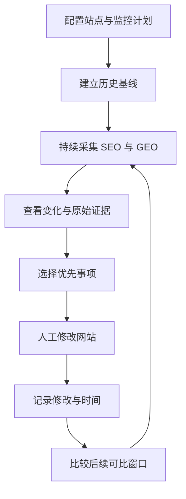
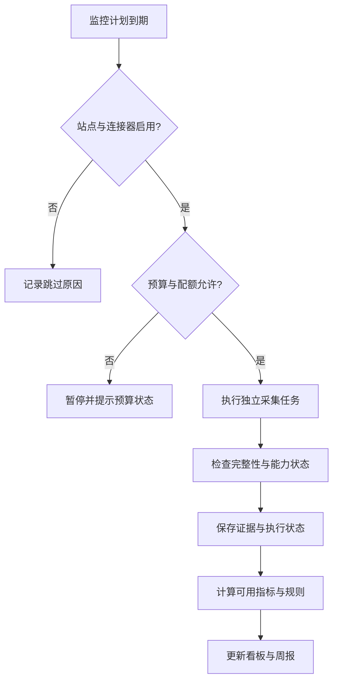
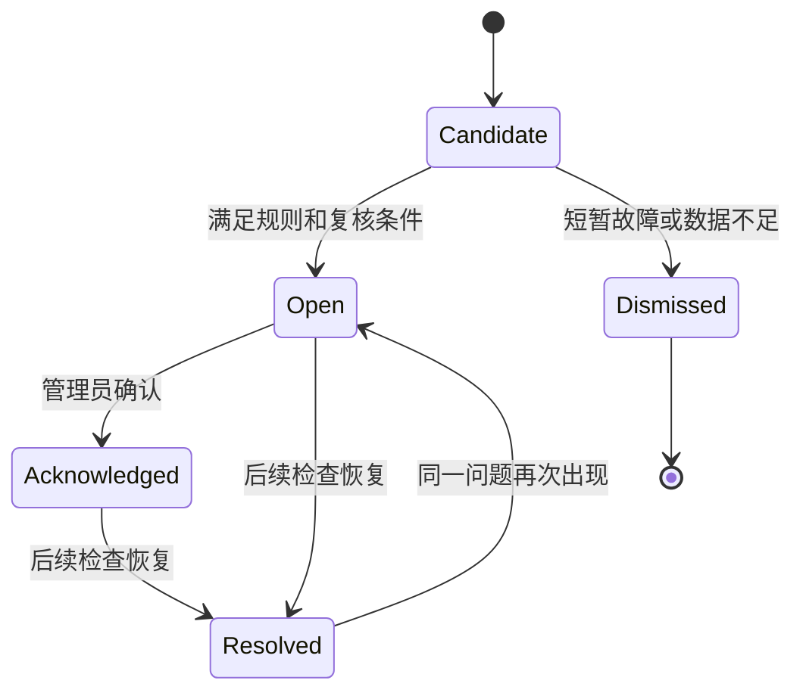

# rankloop MVP：功能、监控口径与验收

日期：2026-10-27。状态：已确认方向的设计基线，待实施验证。

关联文档：[技术方案](technical-design.md) · [模型与 Agent 设计](model-provider-design.md)

## 1. 定位与问题

rankloop 为个人与小型团队提供可自行部署的多站点 SEO / GEO 持续监控。首版关注三个问题：

1. 网站的搜索表现与技术健康发生了哪些值得关注的变化？
2. 固定用户问题下，AI 是否提及品牌、引用站点内容，以及引用了哪些其他来源？
3. 基于证据应该先做什么，修改以后观察到了什么？

首个真实站点用于验证闭环，但产品配置与业务规则不得硬编码任何个人域名。MVP 不承诺排名、流量或 AI 引用增长，也不将时间相关性解释为因果关系。

## 2. 已确认约束与设计假设

| 类型 | 内容 |
| --- | --- |
| 已确认 | 独立公开仓库；自用为主；多站点；按开源项目标准建设 |
| 已确认 | Agent 模型可自定义，不绑定 OpenAI、Claude、DeepSeek、小米或其他单一厂商 |
| 规模假设 | 首版验证 2 个站点，默认每站点最多巡检 500 个 URL；容量限制可配置 |
| GEO 起点 | 每站点 10–20 个问题、2 个经验证的监测配置；允许仅启用 1 个配置 |
| 访问假设 | 一个实例由一个管理员使用；不提供 SaaS 租户、计费或团队角色体系 |
| 运维假设 | 持续运行的自部署服务与 PostgreSQL；外部付费接口由使用者自行开通 |

以上规模是实施验收的起点，不代表已测出的性能上限。

## 3. 数据边界

| 数据 | MVP 解释 | 不应作出的推断 |
| --- | --- | --- |
| GSC 搜索指标 | Google 报告的点击、展示、CTR、平均排名 | 平均排名等于固定地区实时 SERP 排名 |
| 页面巡检 | 当前 HTTP、HTML 和页面配置状态 | 200 响应意味着已被 Google 索引 |
| URL Inspection | Google 已知的索引版本状态 | 等于当前页面实时可索引性测试 |
| 供应商原生搜索采样 | 某 API、模型和配置下的提及与引用 | 等于对应消费端产品的全部实际曝光 |
| rankloop 搜索增强采样 | 自建检索加所选模型的回答结果 | 等于模型厂商原生搜索产品表现 |

Google URL Inspection API 目前仅检查 Google 索引中的版本，不能执行 live test。[官方说明](https://developers.google.com/webmaster-tools/v1/urlInspection.index/inspect)

Google 已有 AI Overviews / AI Mode 生成式 AI 表现报告；其自动接入依赖可验证的官方接口或导出机制。MVP 预留连接器，不以该自动接入为完成条件，也不以 Gemini API 结果替代它。[官方报告说明](https://support.google.com/webmasters/answer/16984139?hl=en)

## 4. 功能需求

所有 P0 构成 MVP。P1 是后续候选，不影响 P0 验收。

| ID | 优先级 | 功能 | 验收结果 |
| --- | --- | --- | --- |
| F01 | P0 | 多站点配置 | 独立设置域名范围、品牌别名、GSC property、语言、地区、重点页面与主题；停用一个站点不影响其他站点 |
| F02 | P0 | 数据源与模型配置 | 非敏感配置可导出；凭据仅保存引用；站点可以分别选择分析模型与 GEO 监测配置 |
| F03 | P0 | GSC 历史与增量同步 | 首次回填约 90 天，之后滚动更新；展示数据截止日期、状态与采集错误 |
| F04 | P0 | SEO 趋势 | 站点、页面、查询词分别查看点击、展示、CTR、平均排名与可比窗口变化 |
| F05 | P0 | 页面发现与巡检 | sitemap 和人工重点 URL 列表发现页面；记录状态码、重定向、canonical、robots、noindex、标题、描述与变化 |
| F06 | P0 | 索引轮巡 | 按预算检查重点、新增和异常页面，显示最近检查时间与 Google 已知状态 |
| F07 | P0 | GEO 问题与版本 | 管理问题文本、主题、品牌或非品牌分类、语言与版本；变更后保留旧版本 |
| F08 | P0 | GEO 采样与证据 | 固定配置执行，保存回答、引用、搜索来源、能力状态、用量和错误；记录哪些元数据不可观测 |
| F09 | P0 | GEO 趋势 | 查看品牌提及率、站点引用率、主题覆盖率、引用来源分布；展示有效样本数和采集成功率 |
| F10 | P0 | 异常与周报 | 规则识别、去重、恢复状态；站内提醒与每周摘要；无变化不重复产生提醒 |
| F11 | P0 | Agent 分析 | 所选模型基于证据生成解释、优先级和草稿；模型不可用时采集与规则计算仍正常运行 |
| F12 | P0 | 优化记录 | 关联站点、页面、问题及修改时间，查看修改前后窗口与同时发生的其他变化 |
| F13 | P0 | 开源可复现 | 合成演示数据、无外部付费接口的演示流程、部署说明、迁移、CI 与核心测试 |
| F14 | P1 | 扩展数据源与通知 | SERP、AI 转介访问数据、Google 生成式 AI 报告、其他搜索平台、可选外部通知 |

MVP 不包含：计费、公开注册、多租户权限体系、全网关键词库、外链库、绕过消费端限制的浏览器采集、全站浏览器渲染、自动改站或自动发布内容。站外通知必须由部署者显式启用，不自动向他人发送消息。

## 5. 持续监控计划

| 任务 | 默认频率 | 预算与边界 |
| --- | --- | --- |
| GSC 同步 | 每日 | 首次约 90 天，之后重拉最近 7 天；记录初步与最终数据 |
| sitemap 发现 | 每日 | 递归 sitemap 有深度、URL 数量和下载大小限制 |
| 重点页面巡检 | 每日 | 受每站点并发、速率与 URL 上限约束 |
| 全站巡检 | 每周 | 默认每站点最多 500 个 URL，超限报告覆盖范围 |
| URL Inspection | 每日轮巡 | 新增、异常、重点页面优先，遵循来源配额 |
| GEO 基线采样 | 每周三次 | 每个问题每次 3 个样本；监测时区和计划固定 |
| 规则计算 | 每批采集完成后 | 仅处理满足完整性条件的数据窗口 |
| 周报 | 每周一次 | 即使分析模型不可用，也生成规则与指标摘要 |

20 个问题 × 2 个配置 × 3 个样本 × 每周 3 次 = 每站点每周 360 次回答采样，另计重试和可选分析调用。少量重复样本用于观察波动，不能自动解释为统计显著性或独立随机抽样。

运行前校验问题数、配置数、重复数、输出上限、并发与调用预算。价格未知时显示费用未知，仍执行调用次数硬上限；不能将未知费用记为零。多站点预算汇总后还要受实例总预算约束。

## 6. 指标契约

### 6.1 SEO

- 站点总量、页面汇总与查询词明细分别查询、存储和展示，不通过求和查询词明细还原站点总量。
- CTR = 同一粒度点击合计 / 展示合计；展示为零时显示不可计算。
- 平均排名使用 GSC 对应粒度返回值；跨日汇总需按展示加权且保留来源粒度，不能直接平均每行排名。
- 保留 GSC 来源日期和来源时区，不将 PT 日期直接当作北京时间自然日；执行时间另外存 UTC。
- 采集失败、来源缺失、初步数据和明确零值采用不同状态。
- GSC API 不保证返回全部明细；分页、截断和覆盖情况需要显式记录。[Search Analytics API](https://developers.google.com/webmaster-tools/v1/searchanalytics/query)

### 6.2 GEO

指标的比较单位为：站点 × 问题集版本 × 问题版本 × 监测配置版本 × 语言 × 请求地区设置 × 采样模式 × 时间窗口。所选维度不支持地区控制时标为不可控制，不伪造实际用户地域。

| 指标 | 分子 | 分母 |
| --- | --- | --- |
| 品牌提及率 | 明确提及品牌的有效回答数 | 品牌匹配可判定的有效回答数 |
| 站点引用率 | 存在目标域名实际引用的回答数 | 引用可判定的有效回答数 |
| 主题覆盖率 | 固定问题集中至少一次引用目标站点的问题数 | 当前固定问题集中的问题总数，同时显示已完成采样的问题比例 |
| 引用来源分布 | 各域名出现在实际引用中的回答数 | 可判定引用的回答数；一个回答对同一域名最多计一次 |

品牌提及采用归一化别名与明确边界匹配；易混淆别名进入待复核状态。品牌问题与非品牌问题分开统计。站点引用通过解析后的域名与已配置子域范围匹配，不用字符串包含判断。

`sources consulted` 与 `citations in answer` 分开存储：前者是搜索或检索查看过的来源，后者是回答实际引用。只有后者参与站点引用率。接口不能提供完整引用判断时，状态为不可观测，不记为未引用。成功回答且引用数据完整、引用列表为空，才记为未引用。

主题覆盖率仅在固定问题集全部满足计划采样量后用于告警；部分完成时标为临时结果。样本数变化、模型路由变化和问题集变化均显示提示，禁止静默连接成同一条趋势。

## 7. 异常规则与界面

| 类别 | MVP 规则原则 |
| --- | --- |
| SEO 波动 | 最近完整 7 天对前 7 天；同时要求绝对变化和相对变化达到阈值，并满足可配置的最低展示量 |
| 技术异常 | 重点页面新增 noindex、错误 canonical、持续 5xx；除确定配置变更外，网络失败需复核后确认 |
| 索引变化 | 同一 URL 已知索引状态变化；保留检查时间，避免宣称实时掉索引 |
| GEO 波动 | 固定版本和足量样本窗口比较；稀疏数据先进入周报，不宣称显著下降 |
| 数据异常 | 授权失效、失败率、连续漏跑、数据过期与预算暂停单独展示 |

具体默认阈值在真实基线验证阶段确定并版本化，不伪装成普适行业标准。基线不足时显示“基线不足”，不执行趋势告警。

异常按站点、规则版本、目标实体生成稳定标识；重复命中更新证据和最后出现时间。恢复后保留历史，重新出现可重新打开。

界面最小集合：多站点总览、站点 SEO 趋势、页面详情、GEO 问题与回答、异常与优化记录、连接器与模型设置。所有指标显示数据截止时间、覆盖范围和样本量。

## 8. 交付顺序与验收

| 阶段 | 交付与验收 |
| --- | --- |
| M0 | 验证只读 GSC、至少两类协议的模型调用与可验证引用链路；形成能力矩阵，不要求所有厂商都有搜索 |
| M1 | 两个站点连续运行 14 天；模拟重启、授权失效、429 与补跑；重复同步不重复计数，单站点失败不阻塞另一个 |
| M2 | 两个可配置 GEO 配置按计划执行；所有指标能追溯原始样本；引用缺失、失败与零引用分别可验证 |
| M3 | Agent 分析可以在不同厂商配置间切换；关闭所有模型后仍能采集、计算规则和展示证据；建议关联有效证据 |
| M4 | 从空数据库按文档启动演示模式；验证迁移与备份恢复；完成许可证选择、贡献说明、核心测试与 CI |

首版成功标准是持续可靠地积累证据并支持每周优化决策，不以短期流量增长作为工程交付的验收条件。

## 9. 实施前需验证的事项

- 真实 GSC property 的权限、历史数据量、数据延迟与配额。
- 使用者选择的模型和地区是否允许调用，能否满足所声明的能力。
- 首批两个 GEO 配置的实际引用元数据完整性与费用。
- 管理员身份验证的具体组件、正式许可证和真实数据保留周期；技术方案提供建议默认值。

这些事项在 M0 或对应阶段验收前关闭；任何不支持的外部能力必须在界面明确标记，不能用推断补成事实。
