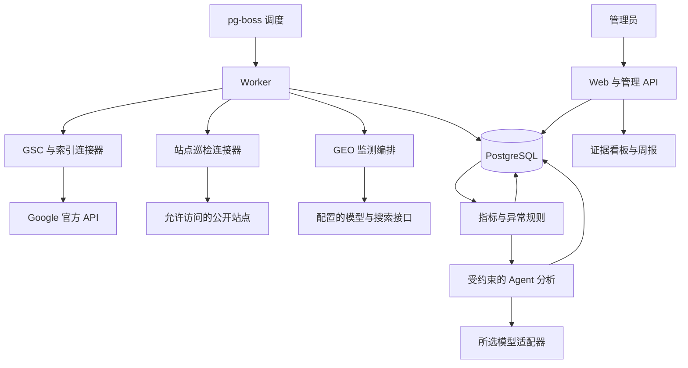
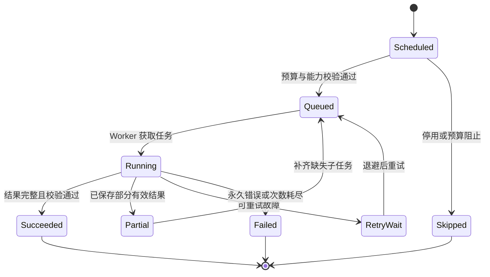
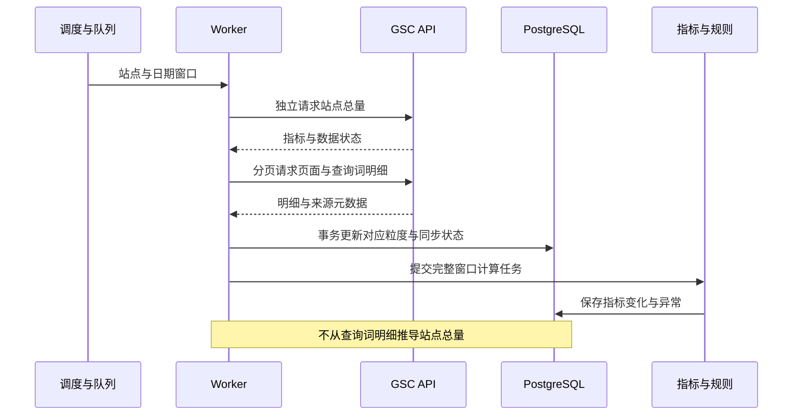
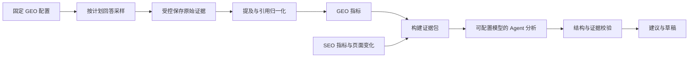
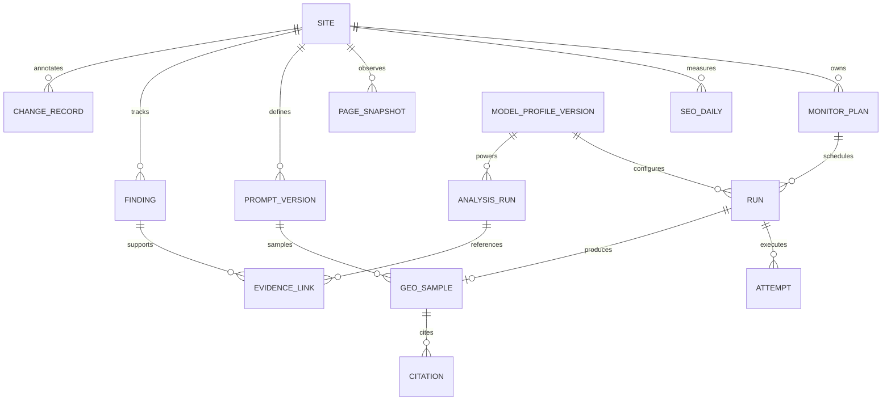
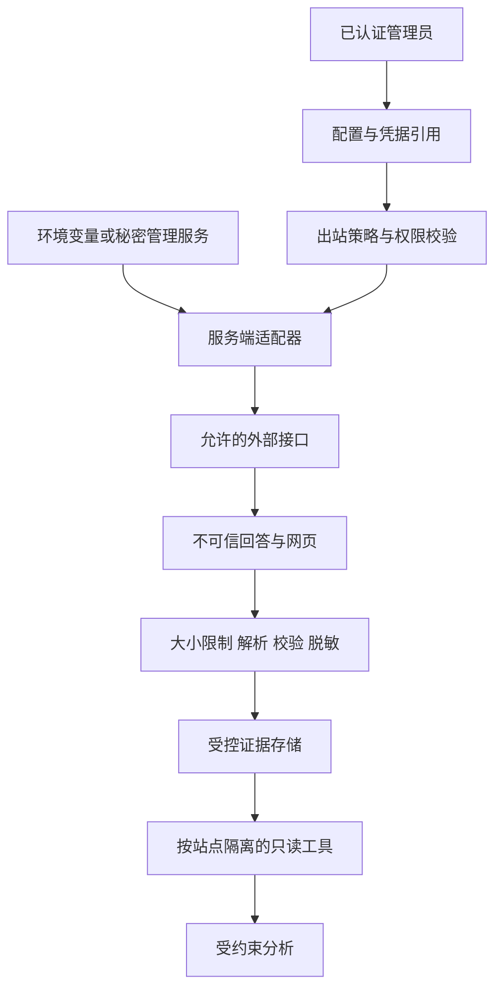

# rankloop MVP 技术方案

日期：2026-10-27。状态：设计基线，尚未实现。

关联文档：[MVP 功能与验收](mvp.md) · [模型与 Agent 设计](model-provider-design.md)

## 1. 目标与技术约束

构建可自行部署、支持多站点的持续监控系统。采集任务应可恢复、指标应可追溯、模型应可替换；即使分析模型不可用，采集、规则计算和证据展示仍然工作。

外部约束包括：GSC 数据延迟与明细限制、索引检查配额、站点抓取速率、模型 API 差异、引用元数据缺失和 AI 回答波动。具体功能与指标契约以 [MVP 文档](mvp.md) 为准。

## 2. 方案比较与决策

| 方案 | 收益 | 代价 | 结论 |
| --- | --- | --- | --- |
| 定时脚本与静态报表 | 验证快、部署轻 | 多站点、恢复、历史比较和配置分散 | 可用于 M0 原型，不作为最终 MVP 架构 |
| Web、Worker 与 PostgreSQL | 持久化、可追溯、可扩展，运维组件有限 | 需要应用和数据库维护 | 采用 |
| 多租户 SaaS 与微服务 | 支持商业化与独立扩容 | 显著增加权限、运维和计费范围 | 后续重新评估 |

采用独立仓库内的小型 monorepo 和模块化单体，运行时分为 Web 与 Worker。首版不引入 Redis、向量数据库或通用 Agent 平台作为必要依赖。

| 层 | 建议技术 | 决策理由 |
| --- | --- | --- |
| Web 与管理 API | Next.js、TypeScript | 配置与看板共享类型，支持 Node.js / Docker 自部署 |
| Worker | Node.js、TypeScript | 采集任务与 Web 请求生命周期分离 |
| 数据库 | PostgreSQL | 指标、快照元数据、执行与任务持久化统一管理 |
| 任务队列 | pg-boss | 复用 PostgreSQL，提供计划、重试、并发控制与失败任务处理 |
| 页面采集 | HTTP 与 HTML 解析 | 默认低成本抓取；浏览器渲染不作为 MVP 依赖 |
| 模型调用 | 自有领域接口与协议适配器 | 业务层不依赖供应商 SDK；具体客户端库在实施时核验 |
| 参考部署 | Docker Compose | Web、Worker、数据库可在通用主机复现 |

Node.js 与数据库版本在实现时选择互相兼容、仍受支持的版本并固定依赖。上述选型依据见 [Next.js 部署](https://nextjs.org/docs/app/getting-started/deploying) 与 [pg-boss 官方仓库](https://github.com/timgit/pg-boss)。

## 3. 系统架构

图中的规则计算与 Agent 分析均由 Worker 内的任务处理器执行，并非额外部署的服务。数据读取和写入经过同一授权、站点范围与领域校验。

### 3.1 模块职责

以下是目标目录职责，本次文档提交不创建实现目录：

| 模块 | 输入与输出 | 边界 |
| --- | --- | --- |
| apps/web | 管理请求 → 配置、看板、任务状态 | 不在 HTTP 请求中执行长时间抓取 |
| apps/worker | 持久化任务 → 执行记录与证据 | 调用领域服务，限制并发和预算 |
| packages/core | 证据与配置 → 指标、异常、版本和比较结果 | 不依赖供应商请求或响应类型 |
| packages/connectors | 来源请求 → 标准化结果与来源元数据 | GSC、巡检、原生搜索分别实现 |
| packages/models | 模型请求 → 标准响应、工具调用、能力与错误 | 协议转换、能力校验、费用与用量 |
| packages/agent | 证据任务 → 可验证的解释和建议 | 只读工具、步数限制、输出校验 |
| packages/db | 领域读写 → 参数化数据库访问 | 迁移、事务、唯一约束与站点范围 |

## 4. 任务、可靠性与恢复

系统以计划窗口创建逻辑运行，每次外部调用再生成 attempt。逻辑运行与执行尝试分开，支持补跑、错误追踪与重试费用核算。

- 逻辑任务唯一标识包含站点、任务类型、计划时间、配置版本与目标；GEO 额外包含问题版本和重复样本序号。
- 队列采用可重复交付假设，业务结果通过唯一约束与事务实现幂等，不声称外部接口恰好执行一次。
- 429、临时网络与可恢复服务错误有限重试，尊重 Retry-After，使用退避和抖动；授权失败和不支持的能力不盲目重试。
- Worker 心跳和超时支持崩溃后恢复；同一站点或供应商受并发上限约束。
- 长任务拆成页面或问题级子任务，部分成功不重新执行已完成子任务；不同站点独立推进。
- 补跑必须区分来源历史回填与当前观测：GSC 可回填过去日期，页面和 GEO 补跑只能反映实际执行时刻，不能伪造过去快照。
- 每次真实尝试记录用量，重试不能消除已发生的调用费用。未知费用保持未知并受调用数硬上限限制。

## 5. SEO 采集链路

### 5.1 GSC

使用只读授权；property 与站点关联关系必须校验。首次约 90 天回填，后续滚动重拉最近 7 天。保留来源日期、来源时区、采集时间、数据初步或最终状态及同步批次。

分别查询站点总量、页面汇总与查询词明细，必要的国家和设备维度只在显式选择的明细粒度采集，避免组合爆炸。分页不代表来源保证完整，需要保存来源限制和实际覆盖信息。重拉完成后按对应日期与粒度事务替换该批结果，避免来源修订后残留旧行；不进行无范围数据清理。

CTR 和平均排名遵循 [MVP 指标契约](mvp.md#6-指标契约)。官方接口与数据状态见 [Search Analytics API](https://developers.google.com/webmaster-tools/v1/searchanalytics/query)。

### 5.2 页面发现、巡检与索引

页面发现来自 sitemap 与人工重点列表。URL 规范化保留原始 URL，并记录实际重定向和 canonical；不得一开始合并不同页面而丢失配置错误证据。

巡检保存 HTTP 状态、有限重定向链、响应头中的 robots、HTML robots、canonical、标题、描述、内容摘要与哈希、抓取时间。存储有大小限制，默认不永久保存整页 HTML。HTML 未包含有效正文时标注“可能需要渲染”，不据此认定搜索引擎一定看不到内容。

robots 规则按用户代理分别解释，遵守抓取限制；robots 抓取受限与 noindex 分开报告。重点页面轮巡索引状态，Google 选择的 canonical 与页面声明值分别存储。重点页面从允许索引改为 noindex 属于技术配置变化，不宣称已经实时掉索引。

## 6. GEO 与 Agent 链路

GEO 执行采用固定版本的监测配置；Agent 分析采用可替换模型配置。两者可以使用不同厂商，任何分析模型都不自动成为监测对象。

回答文本、供应商搜索来源与回答实际引用分别存储。所有模型选择、能力判定、降级与可比性规则见 [模型与 Agent 设计](model-provider-design.md)。

Agent 不承担计划调度、基础指标计算、是否重试等确定性工作。周报先生成确定性数据摘要，再可选生成模型解释；模型失败时报告保留数据摘要与失败状态。

## 7. 数据模型

该图只表达主要逻辑关系；SEO 运行不要求模型配置，GEO 运行必须绑定配置版本。GEO 逻辑运行至多提交一个最终样本，重试响应保存在 attempt 证据中，不被额外累计成计划样本。

| 实体 | 关键内容与约束 |
| --- | --- |
| site / monitor_plan | 域名与允许范围、GSC property、品牌别名、语言、时区、计划与预算；每次配置修订版本化 |
| run / attempt | 计划时间、实际时间、任务唯一标识、状态、错误类型、用量、重试与覆盖率 |
| seo_daily | 按站点、日期、来源、粒度、维度集合唯一；可实现为站点、页面、查询词独立物理表 |
| page_snapshot / index_inspection | 原始 URL、规范化标识、配置摘要、哈希、状态、抓取或检查时间 |
| prompt_set_version / prompt_version | 固定成员、问题文本、主题、分类与版本，修改不覆盖历史版本 |
| model_profile_version | 协议、端点非敏感标识、模型名称、参数、能力快照、凭据引用，禁止保存凭据明文 |
| geo_sample / citation / consulted_source | 实际回答、提及判定、引用状态与实际引用、搜索来源、来源观察时间 |
| finding / evidence_link | 规则版本、目标、生命周期、证据类型与标识；按站点验证所有引用 |
| change_record / analysis_run | 修改说明、发生时间、对比窗口、分析配置版本、输出与验证结果 |

所有业务表带 site_id 或通过强约束关联站点。主要查询索引围绕 site_id + date/time、实体 + observed_at、运行状态 + scheduled_at；比较数据按来源粒度选取，避免任意维度拼接导致重复计数。

### 7.1 保留、备份与清理

建议默认：日聚合与优化记录保留 24 个月，受控的原始回答与页面证据保留 90 天；保留策略可配置。过期原始证据显示明确的过期状态，保留摘要、哈希与来源标识，不伪装成仍可回放全文。

清理按站点、数据类型与截止日期显式限定，先显示影响数量并由管理员批准；备份遵循同样的数据访问和加密策略。数据库每日备份，正式发布前验证从备份恢复与数据库迁移。实际恢复耗时需要演练后记录，不在设计阶段声称已达到恢复目标。

## 8. 管理 API 与配置

管理 API 属于单管理员实例内部接口，不在 MVP 承诺稳定公共 API。

| 操作 | 设计约束 |
| --- | --- |
| 管理站点、问题集与计划 | 登录与站点范围检查；输入长度、URL 数、计划频率和预算上限校验 |
| 配置模型与能力 | 仅管理员；返回非敏感配置和凭据引用状态，绝不回传凭据 |
| 手动运行与补跑 | 生成稳定运行标识；异步返回运行状态；受同一预算与并发约束 |
| 查询趋势与证据 | 限定站点、时间范围、分页与行数；明确粒度和缺失状态 |
| 导出与清理 | 导出脱敏；清理需显式范围、预览与管理员确认 |

API 错误至少区分授权不足、配置无效、能力不支持、预算阻止、来源限流、来源不可用和结果校验失败。使用 Cookie 会话时覆盖 CSRF 与会话安全；身份验证组件在 M0 选择成熟实现，不自行设计密码协议。

## 9. 安全与信任边界

- 凭据由运行环境或批准的秘密管理系统注入，数据库只保存引用。不得读取凭据文件并提交到仓库；日志不记录认证头、完整请求或私人查询内容。
- 页面抓取与模型端点使用不同出站策略。页面巡检禁止内网、环回、链路本地与云元数据地址；解析 DNS、IPv4/IPv6、每次重定向均校验，使用受控网络连接防止 DNS 重绑定。
- 自定义模型端点仅由实例管理员配置，默认 HTTPS 与显式主机允许列表；本地模型仅能由部署者在运行配置中显式授权固定端点，不能通过站点 URL 或模型输出开启任意内网访问。
- 认证信息仅发送到对应配置的受信端点；拒绝跨主机认证重定向、URL 内嵌凭据和任意用户提供的认证头。
- 网页、问题、引用与模型输出均为不可信数据；限制长度和格式，安全显示文本，不直接执行 HTML，不将输入拼接为命令、SQL、正则表达式或模板代码。
- 数据库使用参数化访问或安全 ORM；站点、证据和任务 ID 验证归属。导出路径规范化并限制到允许目录。
- 分析工具只读、白名单、服务端授权；网页中的指令不能改变工具权限、目标站点或模型配置。
- 数据外发遵循显式配置：站点证据发送到哪个模型由管理员选择，默认只发送所需的公开内容摘要；分析 fallback 不得越过该出站许可。
- 依赖使用官方 registry 和可验证的项目来源，固定锁文件，CI 检查依赖；不通过非官方代理安装未知包。

## 10. 测试、观测与开源标准

| 层次 | 关键验证 |
| --- | --- |
| 领域测试 | GSC 不同粒度、CTR 与排名口径、缺失值、GEO 分母、品牌与域名边界 |
| 连接器契约测试 | 分页、429、授权失效、引用缺失、部分结果、协议差异；使用合成 fixture |
| PostgreSQL 集成测试 | 幂等、事务、配置版本、任务重试、迁移和站点隔离 |
| 安全测试 | SSRF 与重定向、越权证据引用、提示注入、输出转义与脱敏 |
| 端到端验证 | 演示模式从配置到采集、异常、报告、修改记录；无需付费 API |
| 可选真实验收 | 使用者显式配置的账号做兼容性测试；不在默认 CI 触发付费调用 |

运行观测包括：任务延迟、成功与失败率、数据新鲜度、巡检覆盖率、引用可观测率、分析校验失败、供应商限流、调用次数与费用状态。日志采用站点与运行的非敏感标识，不打印正文或认证信息。

正式开源发布须具备 README、LICENSE、贡献指南、行为规范、安全披露渠道、演示数据、配置参考、Docker Compose、数据库迁移、备份恢复与升级说明。默认 CI 检查类型、构建、核心测试、文档链接和 Mermaid 语法；外部依赖的调用需显式启用。生产数据库与监控数据不存放在 Git 仓库。

## 11. 风险与实施顺序

| 风险 | 影响 | 应对与验证 |
| --- | --- | --- |
| 来源数据修订或缺失 | 错误趋势和误报 | 重拉窗口、独立总量、完整性状态与基线门槛 |
| API 与消费端差异 | 高估实际 GEO 曝光 | 明确采样模式和产品标识，禁止替代解释 |
| 模型更名、路由或参数变化 | 时间序列不可比 | 配置版本、返回模型元数据、能力快照与变化提示 |
| 外部费用增长 | 多站点放大调用量 | 实例与站点预算、有限重试、费用未知状态 |
| 页面抓取与模型提示注入 | 内网访问或越权 | 出站隔离、只读工具、站点授权与攻击 fixture |
| 自部署环境差异 | 难以复现 | 固定版本、演示模式、迁移与备份恢复演练 |

实施顺序采用 [MVP 里程碑](mvp.md#8-交付顺序与验收)。M0 优先验证外部能力和跨协议抽象；上线先启用一个真实站点，再验证第二个站点。发布按版本迁移；回退应用前验证数据库兼容性，破坏性迁移不得自动执行。每个连接器与 Agent 分析均可独立停用，以保留其他采集链路运行。

本次文档不确定具体认证库、客户端 SDK 或 ORM；实施时按兼容性、安全与维护情况选型。此类选择不能改变领域契约、模型可配置性和已有数据口径。
